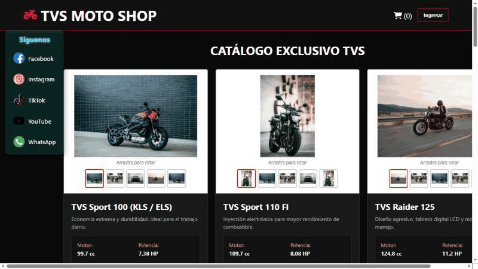
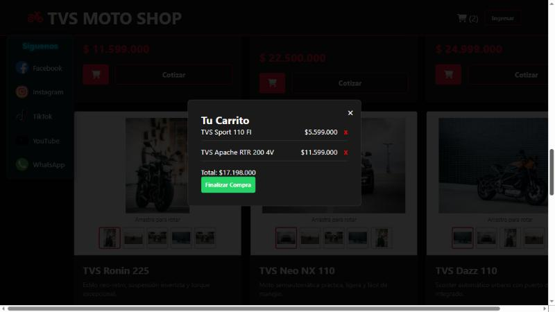
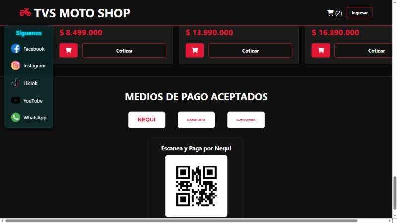

# 🏍️ Moto Shop Race — Tienda en línea de motos

Tienda en línea de demostración para un concesionario de motos en Colombia: catálogo con fotos, carrito de compras, pedido directo por WhatsApp, pagos colombianos por QR y cuentas de usuario.

> Proyecto de portafolio de **Jeison Serrano**. Los productos y precios son de ejemplo.

**Ver la demo:** https://jsonserrano.github.io/moto-shop-race/



| Catálogo | Carrito | Medios de pago |
|---|---|---|
|  |  |  |

## Funciones
- **Catálogo TVS** de 15 modelos con ficha técnica (motor, potencia, peso, frenos) y precio en pesos.
- **Visor 360°**: arrastra la foto con el mouse o el dedo para girar entre las 5 vistas de cada moto.
- **Carrito de compras** y **pedido por WhatsApp** con el resumen listo para enviar.
- **Pagos colombianos**: Nequi, Daviplata, Bancolombia y PSE con código QR.
- **Cuentas de usuario**: registro e inicio de sesión en el navegador (funciona sin servidor) y una API opcional en Node/Express con contraseñas cifradas (bcrypt).
- **Diseño oscuro** y adaptable a celular, tablet y computador.
- **Base de datos SQL** de referencia (`database.sql`) para llevarla a MySQL.

## Tecnologías
HTML5 · CSS3 · JavaScript (ES6) · Node.js + Express · bcryptjs · SQL · Font Awesome

## Cómo ejecutarla
```bash
git clone https://github.com/Jsonserrano/moto-shop-race.git
cd moto-shop-race
npm install
npm start          # API opcional de cuentas en http://localhost:3000
```
Para ver la tienda basta con abrir `MotoShopRace_index.html` (o `index.html`) en el navegador; no necesita servidor.

`usuarios.json` se crea solo al registrar la primera cuenta (no se sube a GitHub). Para usar PHP/MySQL hay un ejemplo de conexión en `config.ejemplo.php`.

## Estructura
```
MotoShopRace_index.html   página principal (index.html la abre)
styles.css · script.js    estilos y lógica (catálogo, carrito, WhatsApp, pagos)
server.js                 API de registro e inicio de sesión
database.sql              modelo de base de datos
config.ejemplo.php        ejemplo de conexión PHP/MySQL
```
